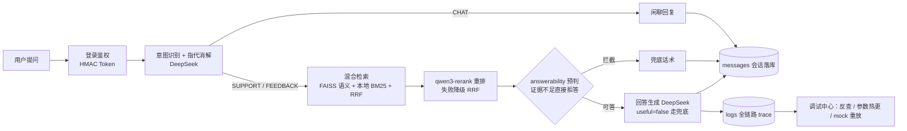

# 产品咨询智能客服 · RAG 知识库 AI 问答系统

[](https://github.com/xlb1266/product-qa-rag-assistant/actions/workflows/ci.yml)
[](LICENSE)


用户提问后，系统先走「意图识别 → 混合检索 → 重排 → 拒答预判」链路取回知识，再交给大模型生成回答。回答严格以检索内容为依据，证据不足时**由代码层直接拒答**（不依赖模型自觉），全链路 trace 落库可观测，并用 40 题评测集 + LLM-as-a-Judge 做质量门禁。

## 核心亮点

| 方向 | 做了什么 |
|------|---------|
| 混合检索 | 语义（百炼 text-embedding-v4 + FAISS）+ 关键词（自研中文 bigram BM25）双路召回 → RRF 融合 → qwen3-rerank 重排，重排失败自动降级 RRF 排序保证链路可用 |
| 防幻觉 | 三层防线：rerank 阈值过滤 → 代码层 answerability 预判（证据不足不进 LLM）→ `useful=false` 统一兜底话术；拒答从"模型自觉"变为"代码保证" |
| 评测驱动 | 40 题人工校对评测集（28 可答 / 8 不可答 / 4 模糊），检索层确定性指标 + LLM 裁判（Faithfulness / Answer Relevance），`thresholds.json` CI 门禁跌破即红灯，改前改后各跑一次对比 |
| 可观测 | 每次问答按统一节点契约（`docs/pipeline-nodes.md`）生成 trace 落库，调试页可按请求编号反查、改参数热生效、一键回滚、mock 重放（不花钱复现检索行为） |
| 权限安全 | pbkdf2 密码哈希 + 自签 HMAC-SHA256 Token（零第三方依赖），双角色 RBAC，角色实时读库防旧 token 提权，越权访问写安全日志留痕 |

## 架构



前端页面：在线咨询、知识库管理、分块详情、日志列表/详情、用户管理、调试中心、登录/注册。

## 技术栈

| 层 | 技术 |
|----|------|
| 后端 | Python 3.12 + FastAPI + FAISS + SQLite（自研 BM25，零额外依赖） |
| 依赖管理 | uv |
| 前端 | React 18 + TypeScript + Vite |
| 大模型 | DeepSeek API（意图 / 回答 / 闲聊 / 裁判） |
| 向量模型 | 阿里百炼 text-embedding-v4（1024 维） |
| 重排模型 | 阿里百炼 qwen3-rerank |
| 测试 | pytest 单测（41 项，无外部依赖）+ 离线评测门禁 `eval/run_eval.py --ci` |
| CI | GitHub Actions：后端 ruff + pytest，前端 tsc + vite build |

## 快速开始

### 本地开发

```bash
# 1) 后端
cd backend
cp .env.example .env        # 填入 DEEPSEEK_API_KEY / DASHSCOPE_API_KEY
uv sync
uv run uvicorn app.main:app --reload --port 8000

# 2) 前端（另开终端）
cd frontend
npm install
npm run dev                 # http://localhost:5173，/api 已代理到 8000
```

登录后在「知识库管理」上传 `test-data/空气小猪产品知识库.md` 即可问答。内置测试账号：`admin@app.com` / `user@app.com`，密码 `123456`（见 `test-data/accounts.md`）。

### Docker

```bash
cp backend/.env.example backend/.env   # 填入 Key
docker compose up --build              # 前端 http://localhost:5173，后端 http://localhost:8000
```

### 跑测试

```bash
cd backend
uv run pytest              # 单测：分块/BM25/RRF 融合/拒答预判/鉴权，全部离线
uv run ruff check app eval tests
```

## API 一览

| 方法 | 路径 | 权限 | 说明 |
|------|------|------|------|
| POST | /api/auth/register · /api/auth/login | 公开 | 注册 / 登录，返回自签 Token |
| GET | /api/auth/me | 登录 | 当前用户信息 |
| POST | /api/chat | 登录 | 问答主链路，响应带 log_id |
| GET / DELETE | /api/messages | 登录 | 本人历史消息（跨设备同步） |
| POST | /api/documents/upload | 管理员 | .md 入库：分块 → 向量化 → FAISS + SQLite |
| GET / DELETE | /api/documents · /{id} | 管理员 | 文档列表 / 详情 / 删除（向量同步清理） |
| GET | /api/logs · /{id} | 管理员 | 全链路 trace 列表 / 详情 |
| GET / PUT | /api/users · /{id}/role | 管理员 | 用户列表 / 改角色（留痕） |
| GET | /api/users/role-changes · /api/security-logs | 管理员 | 角色变更 / 安全事件审计 |
| GET / PUT | /api/debug/config | 管理员 | 运行时参数查看 / 修改（校验后热生效） |
| POST | /api/debug/config/{key}/rollback · /api/debug/replay | 管理员 | 参数回滚 / 按 log_id 重放链路 |
| GET | /api/health | 公开 | 健康检查 |

## 评测体系（质量门禁）

评测集 `backend/eval/dataset.json`：40 题逐条人工校对，`expected_keywords` 绑定 chunk 正文而非 chunk_id，改切分策略后可直接复用。

**实测结果**（完整报告见 `docs/eval/基线报告-2026-09.md`）：

| 指标 | 基线（v1） | 阶段 2 防幻觉后 | CI 门禁下限 |
|------|-----------|----------------|------------|
| rerank Recall@4 | 0.9286 | 0.9286 | 0.90 |
| RRF Recall@8 | 1.0000 | 1.0000 | 0.95 |
| rerank MRR | 0.8393 | 0.8393 | 0.78 |
| answerable 回答准确率 | 0.9286 | 0.9286 | 0.85 |
| unanswerable 拒答正确率 | 1.0000 | **1.0000（代码层保证）** | 1.00 |
| Faithfulness（LLM 裁判） | 0.9259 / 0.9444 | **0.9444** | 0.90 |
| Answer Relevance（LLM 裁判） | 1.0000 | 1.0000 | 0.90 |

评测驱动的关键结论：

- **回答准确率上限由检索层决定**——本批"检索对了、回答错了"为 0 例，因此优化聚焦检索与阈值；
- **answerability 阈值 0.6 不是拍脑袋**：探针显示 8 条 unanswerable 题检索全为空、answerable 题 top-1 最低 0.6461，0.6 不误伤正常题；拦截后评测 LLM 调用 67 → 54 次；
- **rerank 的价值在过滤**：小库上 RRF 已 recall@8=1.0，rerank+阈值把喂给 LLM 的知识从 4 条压到平均 2.6 条高置信内容，直接利好防幻觉；
- 门禁复跑（需真实 API Key 且知识库已入库）：`uv run python eval/run_eval.py --ci`，7 项任一跌破 `thresholds.json` 退出码 1。

## 防幻觉设计

1. **检索层**：rerank 分数低于 `rerank_threshold` 的候选直接丢弃，不喂给模型；
2. **代码层**：`assess_answerability` 在调用 LLM 前拦截——检索为空或最高分低于 `answerability_threshold`（默认 0.6）直接返回统一兜底话术，线上与评测共用同一实现保证口径一致；
3. **生成层**：回答提示词要求"所有内容有迹可循，宁可不答也不乱答"，`useful=false` 时后端强制替换为兜底话术。

## 可观测与调试

- 每次请求生成 `intent_recognition → retrieval → rerank → answerability → answer_generation` 节点数组（含输入/输出/耗时/状态），落 `logs` 表，`status=degraded` 表示重排降级；
- 调试中心：按请求编号反查 trace、修改检索参数即时热生效（全部校验 + 变更留痕 + 一键回滚）、`mock_third_party` 开关下重放链路——付费调用走模拟，BM25 照常真实执行，不花钱也能验证检索行为。

## AI 辅助开发工作流（本项目的方法论实践）

本项目采用**分阶段提示词 + 评测门禁驱动**的 agent 开发流程，过程资产完整保留在仓库：

- `docs/iteration-prompts/`：四个迭代阶段的驱动提示词（评测 → 防幻觉 → PDF/Word 接入 → chunking 优化），每份只下"需求 + 行为要求 + 设计约束 + 产出与验收标准"，关键原则如"拒答判断必须在代码层落实"直接写进约束；
- `docs/eval/`：基线报告与每轮评测结果 JSON，改动前后各跑一次对比，阈值校准依据可追溯；
- `docs/pipeline-nodes.md` / `docs/cross-cutting.md`：跨阶段共享的节点契约与工程约定，保证多轮迭代不跑偏；
- git 历史保留了真实决策轨迹，包括**撤销**（如引用绑定 citations 方案做了两天后因"信息重复、复杂度不值"整体回滚）——为什么撤、撤后复跑门禁全 PASS 都写在提交信息里。

这套流程本身（如何给 agent 定 spec、如何用评测守住回归、如何记录并回滚错误决策）是这个项目想要展示的核心工程能力。

## 目录结构

```
product-qa-rag-assistant/
├── backend/
│   ├── app/
│   │   ├── main.py            # FastAPI 入口
│   │   ├── config.py          # .env 配置（密钥/路径/鉴权）
│   │   ├── api/               # auth / documents / chat / messages / logs / users / debug / health
│   │   ├── core/              # chunker / embeddings / vector_store / bm25 / retrieval
│   │   │                      # reranker / intent / answer / llm / security / runtime_config
│   │   └── db/                # SQLite 访问层 + 建表 + 幂等迁移
│   ├── eval/                  # 评测集 / 指标 / LLM 裁判 / CI 门禁阈值
│   ├── tests/                 # pytest 单测（离线，无外部依赖）
│   └── data/                  # SQLite 与 FAISS 索引（gitignore）
├── frontend/
│   └── src/pages/             # 在线咨询 / 知识库 / 分块详情 / 日志 / 用户 / 调试 / 登录
├── docs/
│   ├── requirements.md        # 需求与功能状态
│   ├── pipeline-nodes.md      # 链路节点契约（日志/调试共用）
│   ├── cross-cutting.md       # 跨阶段工程约定
│   ├── iteration-prompts/     # 四阶段迭代提示词（AI 开发工作流记录）
│   └── eval/                  # 基线报告与评测结果
└── test-data/                 # 知识库样例与边界测试样本
```

## Roadmap

- [ ] 阶段 3：PDF / Word 文档接入（提示词已就绪 `docs/iteration-prompts/阶段3-PDF与Word接入.md`）
- [ ] 阶段 4：chunking 策略优化（基线报告已给出复用评测的方法）
- [ ] `rerank_threshold` 0.6 → 0.5 降档复测（基线报告结论：预期 Recall@4 0.9286 → 0.9643）

## License

[MIT](LICENSE)
