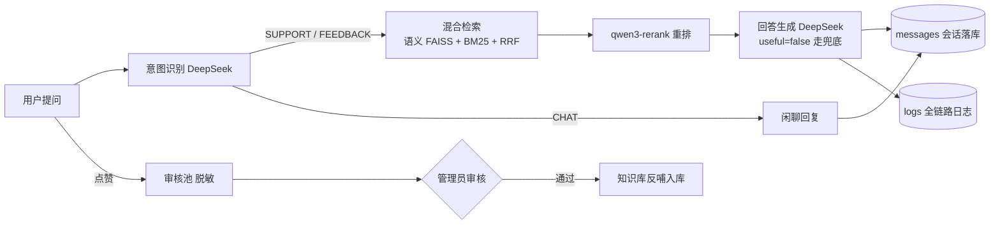

# 项目需求（阶段 0 产出，2026-08-23 补录）

> 项目实际从 2026-08-18 开始构建，本文按剧本要求对既有需求做一次集中补录，供后续阶段与新会话取上下文。

## 1. 项目主体

**产品咨询智能客服**：基于知识库检索（RAG）的智能客服问答系统，服务于「空气小猪」App（熟人社交 AI 语言学习产品）的用户咨询。

## 2. 需求描述

空气小猪产品的用户咨询集中在功能使用、故障反馈与闲聊三类。人工客服成本高、响应慢，且答案散落在产品文档里。本系统把产品知识库文档向量化入库，用户提问后走「意图识别 → 知识库检索 → 重排 → 生成回答」链路自动应答；答不上来时明确兜底不编造（防幻觉）；全链路留日志便于排查；用户点赞的好问答经人工审核反哺知识库，让系统越用越好。

## 3. 链路图

## 4. 功能拆解与完成状态

| # | 功能模块 | 剧本阶段 | 状态 |
|---|---------|---------|------|
| 1 | 项目骨架（FastAPI + React/Vite） | 阶段 2 | ✅ 2026-08-18 |
| 2 | 知识库文档管理（上传/分块/向量化/列表/删除） | 阶段 3 | ✅ 2026-08-18 |
| 3 | 意图识别（三分类 + 指代消解） | 阶段 4 | ✅ 2026-08-19 |
| 4 | 混合检索 + 重排 + 阈值过滤 | 阶段 4 | ✅ 2026-08-19 |
| 5 | 回答生成 + 兜底防幻觉 | 阶段 4 | ✅ 2026-08-19 |
| 6 | 登录 + 会话持久化 | 阶段 4 | ✅ 2026-08-19 |
| 7 | 全链路日志 + 日志页面 | 阶段 5 | ✅ 2026-08-19 |
| 8 | 测试数据（正常 + 边界样本 + 测试账号） | 阶段 1 | ✅ 2026-08-23 |
| 9 | 权限管理（双角色 + 注册 + 接口分级 + 留痕） | 阶段 7 | ✅ 2026-08-23 |
| 10 | 调试功能（参数热生效 + 反查 + 重放 mock） | 阶段 6 | ✅ 2026-08-23 |
| 11 | 数据飞轮（反馈收集 + 审核 + 反哺） | 阶段 8 | ✅ 2026-08-23 |

测试数据见 `test-data/`（accounts.md 含测试账号清单与边界样本对照表）。
